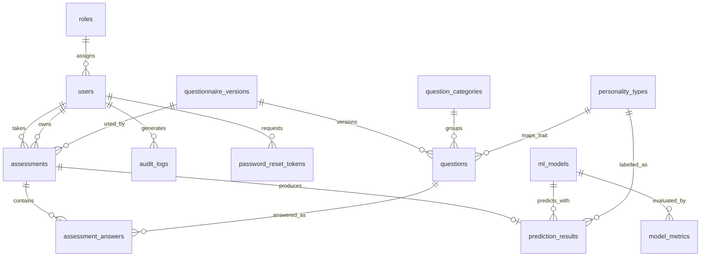
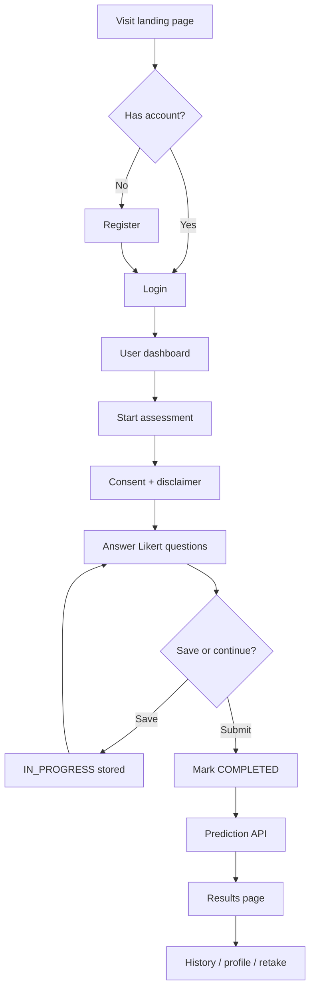
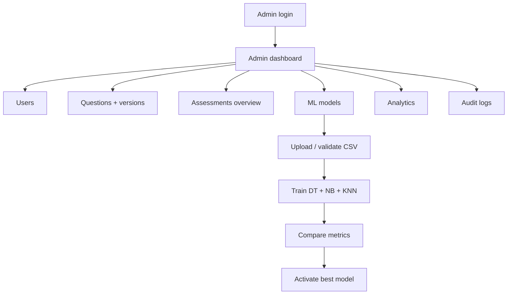
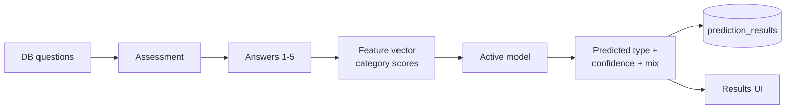
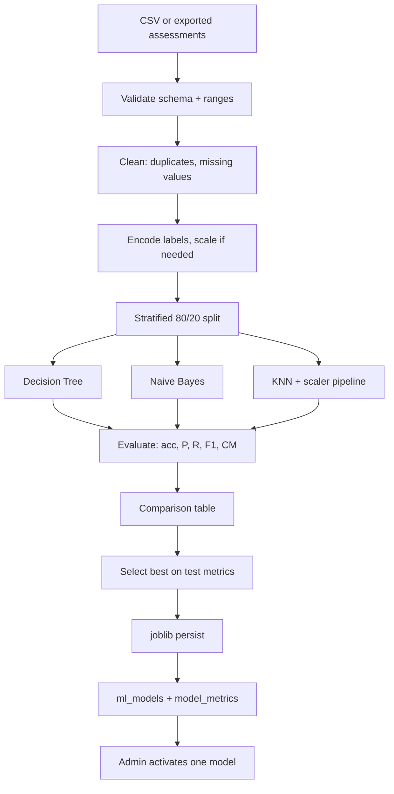

# System Architecture

**Project:** Personality Classification Using Data Mining  
**Type:** University final-year project  
**Document purpose:** Defendable technical design. Implementation follows this document phase by phase.

This document describes *what we will build* and *why*. It is not a claim that every module already exists.

---

## 1. Proposed complete system architecture

The system is a three-layer web application with a dedicated machine-learning engine.

```
  PRESENTATION LAYER
  React + Vite + Tailwind + React Router
  Public site | User dashboard | Admin dashboard
           |
           | HTTPS / JSON (Axios)
           v
  APPLICATION LAYER
  FastAPI REST API
  Auth (JWT) | RBAC | Validation (Pydantic) | Services
          /                    \
         v                      v
  DATA LAYER              ML CLASSIFICATION ENGINE
  MySQL + SQLAlchemy      pandas + scikit-learn
  Users, questions,       preprocess -> train ->
  assessments, results,   evaluate -> persist (joblib)
  models, audit logs      predict via active model
```

### Why this architecture (defence notes)

| Decision | Reason |
|---|---|
| SPA + REST API | Clear separation: UI can change without changing classifiers. Easy to test the API independently. |
| FastAPI | Native Pydantic validation, automatic OpenAPI docs for the project report, async-capable. |
| MySQL + ORM | Assessment data is relational (user → assessment → answers → prediction). Foreign keys protect integrity. SQLAlchemy reduces SQL-injection risk. |
| JWT + RBAC | Stateless auth for a SPA. Roles (`USER`, `ADMIN`) are enforced on the **server**, not only in the UI. |
| Separate ML package | Questionnaire scoring (feature engineering) is not the same as classification. The classifier is a trained model, not `if`/`else` rules. |
| Three classical algorithms | Decision Tree (interpretable), Naive Bayes (probabilistic baseline), KNN (instance-based). Suitable for a modest feature set and for academic comparison. Deep learning is unnecessary and harder to defend on a small labelled set. |

### Two classification paths (must stay distinct)

1. **Feature engineering (always):** Likert answers are aggregated into category scores (leadership, sociability, …). This is *input preparation*, not the final class label.
2. **Trained classifier (production):** A scikit-learn model maps the feature vector to `{Choleric, Melancholic, Phlegmatic, Sanguine}`.
3. **DEMO MODE (temporary only):** A labelled rule-based fallback may exist while no trained model is active. The UI and API must say `DEMO MODE`. Demo metrics must never be presented as research findings.

---

## 2. Recommended project folder structure

```
Character Predictor/
├── README.md
├── .gitignore
├── docs/
│   └── ARCHITECTURE.md          ← this file
├── backend/
│   ├── app/
│   │   ├── main.py              # FastAPI entry
│   │   ├── api/                 # HTTP routers only
│   │   ├── models/              # SQLAlchemy entities (Phase 2+)
│   │   ├── schemas/             # Pydantic request/response
│   │   ├── services/            # Business logic
│   │   ├── repositories/        # Database access
│   │   ├── core/                # Config, security, dependencies
│   │   ├── database/            # Engine, session, migrations
│   │   ├── ml/                  # Training, evaluation, prediction
│   │   └── utils/
│   ├── tests/
│   ├── requirements.txt
│   └── .env.example
└── frontend/
    ├── src/
    │   ├── api/
    │   ├── assets/
    │   ├── components/
    │   ├── layouts/
    │   ├── pages/               # public / user / admin
    │   ├── hooks/
    │   ├── context/
    │   ├── services/
    │   ├── utils/
    │   └── routes/
    ├── package.json
    └── vite.config.js
```

**Separation of concerns:** routers never train models; ML code never talks HTTP; repositories never return JWT tokens. Each layer has one job — this is the cleanest story in a viva.

---

## 3. Database ERD



---

## 4. Main database tables and relationships

| Table | Purpose | Key relationships |
|---|---|---|
| `roles` | `USER`, `ADMIN` | Referenced by `users.role_id` |
| `users` | Accounts, hashed passwords, optional demographics | Has many assessments and audit logs |
| `password_reset_tokens` | Time-limited reset tokens | Belongs to user |
| `personality_types` | Choleric, Melancholic, Phlegmatic, Sanguine + copy | Referenced by questions (trait) and predictions |
| `question_categories` | Leadership, sociability, … | Has many questions |
| `questionnaire_versions` | Versioned instruments | Assessments record which version was taken |
| `questions` | Likert items stored in DB, not in React | Category + optional primary trait + weight + order + status |
| `assessments` | One attempt (`IN_PROGRESS` / `COMPLETED`) | Belongs to user + version |
| `assessment_answers` | One row per question response | Unique `(assessment_id, question_id)` |
| `prediction_results` | Model output + mix percentages | One completed assessment → one result (normally) |
| `ml_models` | Trained artefacts metadata (`TRAINED` / `ACTIVE` / `ARCHIVED`) | At most one `ACTIVE` |
| `model_metrics` | Accuracy, precision, recall, F1, confusion matrix | Belongs to a model |
| `audit_logs` | Admin/system actions | Actor user (nullable for system events) |

### Integrity rules worth defending

- Passwords: hash only (`passlib` + bcrypt). Never store plaintext.
- Answers: unique per assessment + question — prevents duplicate submission of the same item.
- Questions: **deactivate** rather than hard-delete when historical answers exist, so old assessments remain reproducible.
- Models: activating a model archives the previous active one. Predictions store `model_id` so history stays honest.
- Optional gender / age group: collected only if the user provides them; never required for classification.

---

## 5. User workflow



User capabilities: register, login, logout, reset password, edit profile, take/save/submit assessment, view prediction and mix, read type information (description, strengths, development areas, careers), view history, print/download result.

---

## 6. Administrator workflow



Admin capabilities are server-enforced. The React admin routes are a convenience; every mutating admin endpoint checks `role == ADMIN`.

Admins must **not** see another user’s raw Likert answers in a casual list. Analytics are aggregates. Individual answer review, if ever needed for research export, is an explicit, logged action.

---

## 7. Assessment / prediction workflow



Steps the API will perform on classify:

1. Authenticate JWT and confirm the assessment belongs to the caller (or admin).
2. Confirm status is `COMPLETED` and no duplicate prediction unless retake is a new assessment.
3. Load answers, map to category scores using question metadata (weight, category).
4. Apply the **same** preprocessor used at training time.
5. Load the single `ACTIVE` model via joblib.
6. Predict class. If `predict_proba` exists, use it for confidence and mix. If not, use a documented fallback (for example normalised decision-function or distance-based scores) — never invented percentages.
7. Persist `prediction_results` with `model_id`.
8. Return a consistent JSON envelope.

---

## 8. Machine-learning workflow



### Feature philosophy

Likert items are **not** fed as 40+ raw columns if we can avoid it. They are rolled up into theoretically motivated category scores (leadership, organisation, …). That:

- matches the research story (behavioural constructs → temperament class);
- keeps the feature count appropriate for classical models;
- makes Decision Tree splits explainable in the report.

### Honesty rules

- Synthetic seed CSVs are labelled `DEMO/SYNTHETIC`.
- Metrics always come from `sklearn.metrics` on held-out data.
- No hard-coded accuracy numbers in the UI.
- Cross-validation is used when the labelled set is large enough; otherwise the limitation is documented.

---

## 9. Proposed API architecture

Base URL: `/api`

Envelope:

```json
{
  "success": true,
  "message": "OK",
  "data": {},
  "errors": null
}
```

| Group | Examples | Auth |
|---|---|---|
| `/api/health` | Liveness / readiness | Public |
| `/api/auth` | register, login, me, password reset | Mixed |
| `/api/users` | profile | USER / ADMIN |
| `/api/questions` | active questionnaire for taking a test | Authenticated |
| `/api/personality-types` | public descriptions | Public or auth |
| `/api/assessments` | create, answers, submit, list mine | USER |
| `/api/predictions` | classify, get by assessment | Owner or ADMIN |
| `/api/results` | latest and by assessment, with type write-up | Owner or ADMIN |
| `/api/history` | list own assessments with stored type/confidence | USER |
| `/api/admin/users` | list users (no password hashes) | ADMIN |
| `/api/admin/audit-logs` | administrator actions, no Likert answers | ADMIN |
| `/api/admin/questions` | list, create, update, deactivate | ADMIN |
| `/api/admin/assessments` | overview / export | ADMIN |
| `/api/admin/datasets` | validate CSV, DEMO preview, collected features | ADMIN |
| `/api/admin/models` | train DT/NB/KNN; evaluate and activate later | ADMIN |
| `/api/models` | list, train, activate, metrics | ADMIN |
| `/api/analytics` | stored distributions and activity series, no Likert answers | ADMIN |

Routers stay thin. Services orchestrate. Repositories query. ML lives in `app/ml`.

---

## 10. Development roadmap

| Phase | Focus | Status |
|---|---|---|
| 1 | Project architecture and environment setup | **Complete** |
| 2 | MySQL database design (models, constraints, seed plan) | **Complete** |
| 3 | FastAPI + database connection | **Complete** |
| 4 | Authentication and role management | **Complete** |
| 5 | React application shell and routing | **Complete** |
| 6 | Landing page, login, registration | **Complete** |
| 7 | User dashboard | **Complete** |
| 8 | Questionnaire management (API + admin later) | **Complete** |
| 9 | Assessment taking workflow | **Complete** |
| 10 | Dataset preprocessing module | **Complete** |
| 11 | Train Decision Tree, Naive Bayes, KNN | **Complete** |
| 12 | Model evaluation and registry | **Complete** |
| 13 | Prediction API | **Complete** |
| 14 | Personality results dashboard | **Complete** |
| 15 | Assessment history | **Complete** |
| 16 | Admin dashboard | **Complete** |
| 17 | Admin questions management | **Complete** |
| 18 | ML model administration | **Complete** |
| 19 | Analytics | **Complete** |
| 20 | Security, validation, testing | **Complete** |
| 21 | UI polishing and responsiveness | **Complete** |
| 22 | Documentation and deployment preparation | Not started |

**Rule:** do not start the next phase until the current one is verified.

Phase 20 controls: security headers on every response; OpenAPI hidden when `APP_DEBUG` is false; bcrypt passwords capped at 72 bytes; JWT claims are `sub`/`role`/`iat`/`exp` while RBAC still reads the role from MySQL; auth routes are rate-limited; validation errors never echo submitted values; administrators can list `audit_logs` without Likert answers.

Phase 21: public and dashboard shells collapse to a menu on small screens; tables scroll horizontally with a swipe hint; Likert options stay on one row; skip-to-content and `:focus-visible` are present. Scoring and classification are unchanged.

---

## Assumptions (Phase 1–3)

1. Local development first: FastAPI on port `8000`, Vite on port `5173`.
2. MySQL is required from Phase 2 onward; Phase 1 does not create tables.
3. Age **group** (optional) is preferred over storing a full date of birth, to reduce sensitive data.
4. English UI for the demonstration.
5. One active questionnaire version in the first implementation; the schema still supports versions.
6. Python 3.11+ and Node.js 18+ are available on the development machine.
7. No Docker in Phase 1 (can be added later if deployment needs it).
8. The four-temperament model is an educational classification scheme, not a clinical instrument.
9. Schema unit tests use in-memory SQLite so CI does not require MySQL. The deployed engine remains MySQL 8.
10. Local MySQL on this development machine uses passwordless root. Change `DATABASE_URL` if your server differs.
11. `/api/health` is liveness (process only). `/api/health/ready` is readiness (MySQL). That split is intentional so the API process can still be probed when the database is down.
12. Registration always creates a USER. Administrators are seeded or promoted in the database — never via the public register form.
