# User Manual and Presentation Guide

**Project:** Personality Classification Using Data Mining  
**Public name in the UI:** Temperament Lab  
**Live URL:** [https://pc.zebprojecthub.com/](https://pc.zebprojecthub.com/)  
**Screenshots:** Microsoft Edge, 15 November 2026, against the live site

This document is the presenter and examiner walkthrough. It shows how a visitor opens the site, how a **USER** takes an assessment, how an **ADMIN** runs the research console, and how the software is structured (use case, class, object, sequence, activity, ER, component, and deployment diagrams).

> This assessment is intended for educational, research and personal-development purposes and should not be considered a clinical psychological diagnosis.

**Honesty rules for the viva**

- Questionnaire **scoring** (Likert → category features) is not classification.
- Mix percentages and metrics are **stored** values. They are never invented for a slide.
- If a yellow **DEMO MODE** or **DEMO/SYNTHETIC** banner is visible, say so. Do not present those numbers as research findings.
- Screenshots in this file match the live site on the capture date. Counts may change after later assessments.

---

## Contents

1. [How to present the project](#1-how-to-present-the-project)
2. [How people access the system](#2-how-people-access-the-system)
3. [Participant (USER) guide](#3-participant-user-guide)
4. [Administrator (ADMIN) guide](#4-administrator-admin-guide)
5. [UML and design diagrams](#5-uml-and-design-diagrams)
6. [Screenshot index](#6-screenshot-index)

---

## 1. How to present the project

Use **Microsoft Edge**. Open a guest window if you have been testing, so cookies from a previous login do not skip the landing page.

Suggested order (about 8–10 minutes):

| Step | What to show | What to say |
|---|---|---|
| 1 | Landing page | Four educational temperament classes; Likert answers become features; a trained model (or labelled DEMO fallback) produces the class. |
| 2 | How it works | Scoring ≠ classification. |
| 3 | Personality types | Copy comes from the database, same vocabulary as the classifier. |
| 4 | Login as USER | Roles are checked on the server, not only in the menu. |
| 5 | Empty dashboard, then assessment | Cards stay empty until a completed, classified assessment exists. |
| 6 | Results | Language is “Your assessment indicates…”. Point at DEMO MODE if it is on. |
| 7 | Sign out, login as ADMIN | Overview counts MySQL rows; it does not run a new prediction. |
| 8 | Questions / Models / Training | Instrument is versioned in MySQL. 100% scores on the bundled CSV are DEMO/SYNTHETIC. |

### 1.1 Open the live site

Address bar:

```
https://pc.zebprojecthub.com/
```

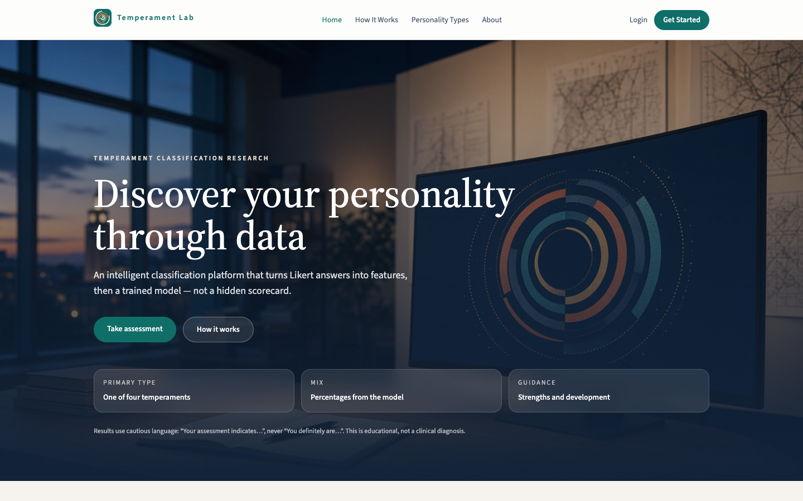

**Talking points**

- Temperament Lab is the public name of the coursework platform.
- Primary type, mix, and guidance are produced after classification — the hero cards describe that pipeline, they are not a result.
- Footer and hero both state that this is educational, not a clinical diagnosis.

### 1.2 Explain the three-step pipeline

Scroll to **How it works** (or use the header link).

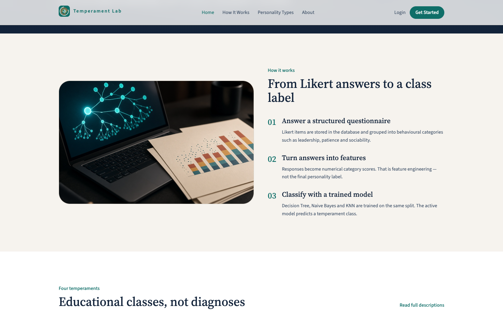

1. Answer a structured questionnaire (32 Likert items in version `v1`).
2. Turn answers into **category features** (leadership, sociability, …). That is feature engineering.
3. Classify with Decision Tree, Naive Bayes, or KNN when an **ACTIVE** model exists. If none is active, the API uses a labelled DEMO fallback and the UI says so.

### 1.3 Show the four classes

Open **Personality Types**.

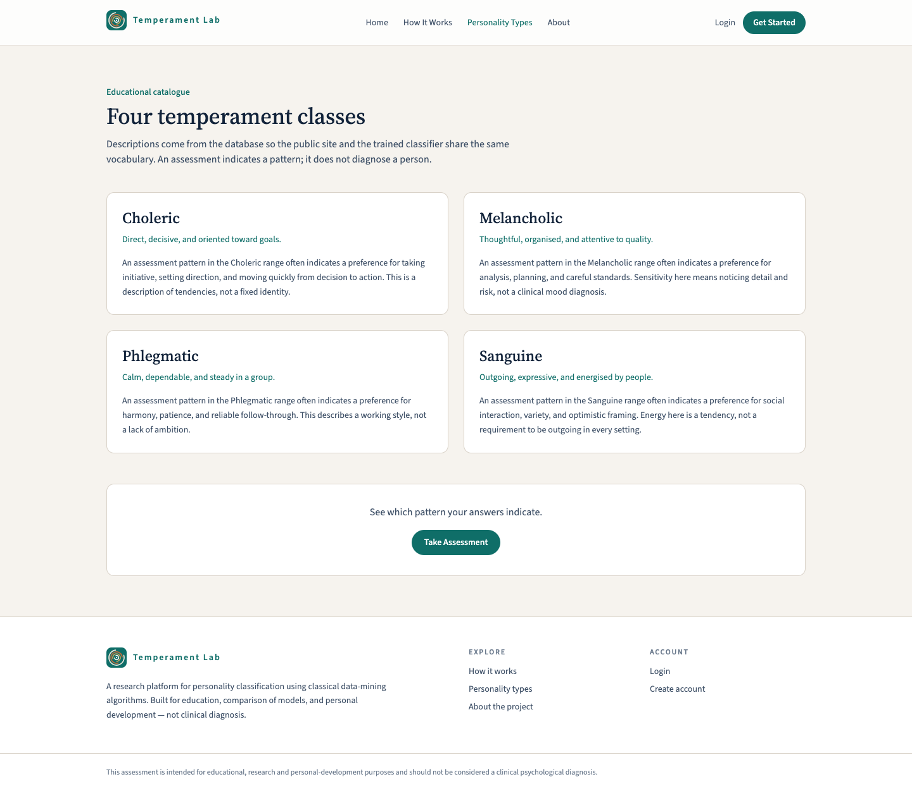

The four labels are Choleric, Melancholic, Phlegmatic, and Sanguine. Descriptions are educational tendencies, not diagnoses.

### 1.4 About page (optional, 30 seconds)

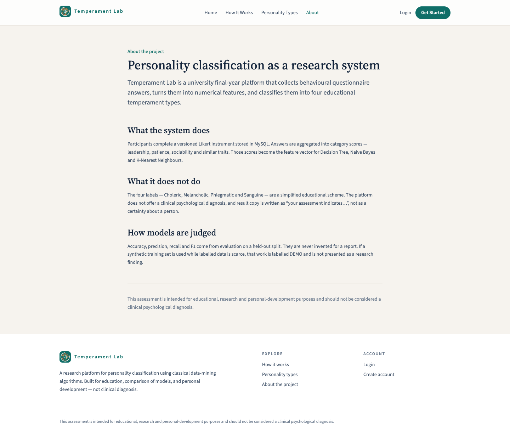

Use this page if an examiner asks “what it does not do” or “how metrics are judged”. Accuracy, precision, recall and F1 come from a held-out split. They are never typed in by hand.

---

## 2. How people access the system

### 2.1 Who can do what

| Audience | How they get in | Where they land |
|---|---|---|
| Visitor | Open the URL. No account. | `/`, `/about`, `/personality-types` |
| New participant | **Get started** → register. Always receives role `USER`. | `/register` then `/app` |
| Existing participant | **Login** with email and password | `/app` |
| Administrator | Seeded or created separately. Self-registration cannot create `ADMIN`. | `/admin` |

JWT is stored in the browser after login. Protected routes (`/app/*`, `/admin/*`) call `/api/auth/me`. The server reads the role from MySQL, not from a client-side flag.

### 2.2 Create a participant account

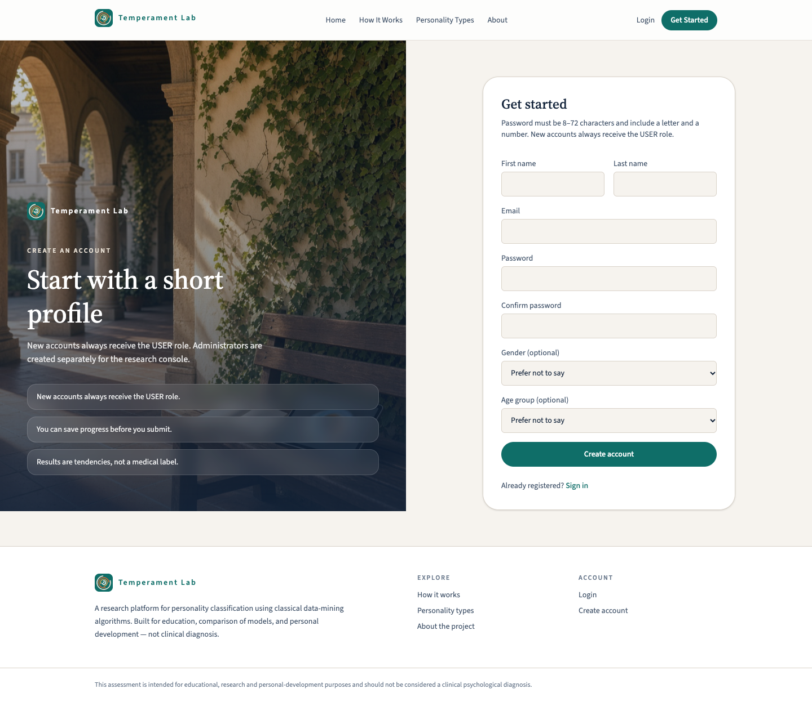

1. Open [https://pc.zebprojecthub.com/register](https://pc.zebprojecthub.com/register) or click **Get started**.
2. Enter first name, last name, email, password, and confirm password.
3. Password must be 8–72 characters and include a letter and a number.
4. Gender and age group are optional.
5. Click **Create account**.

New accounts always receive **USER**. Administrators are created in the seed / research console, not through this form.

### 2.3 Sign in (USER or ADMIN)

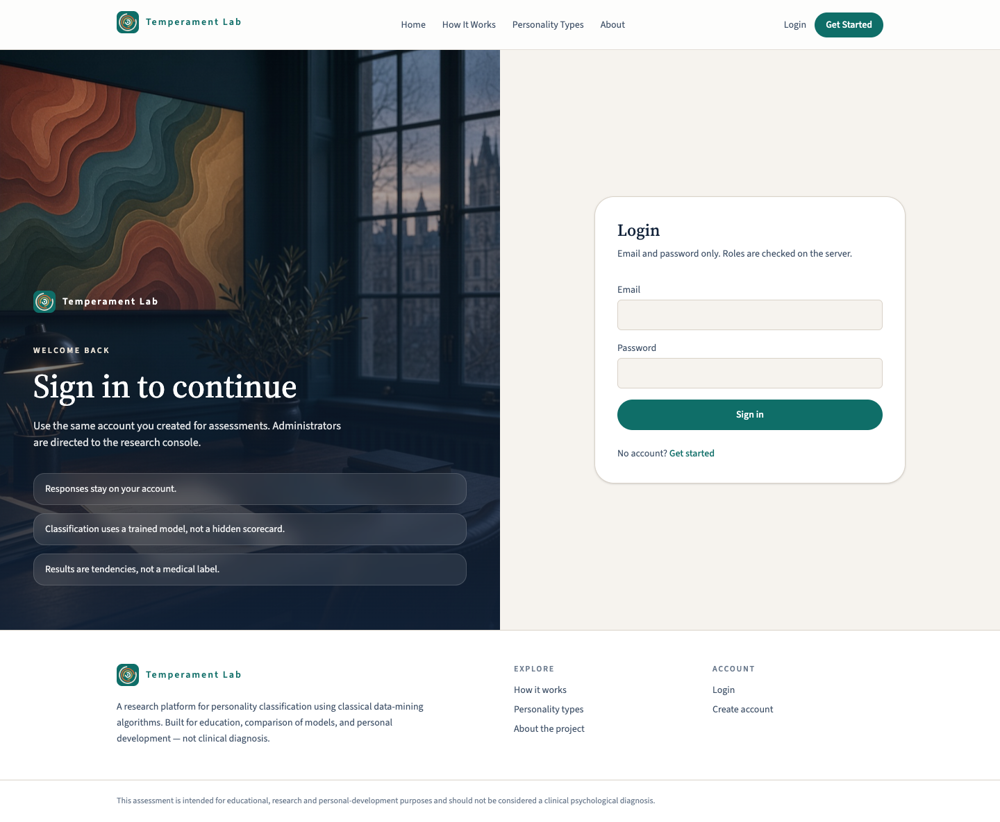

1. Open [https://pc.zebprojecthub.com/login](https://pc.zebprojecthub.com/login).
2. Email and password only.
3. **Sign in**.
4. `USER` is sent to `/app`. `ADMIN` is sent to `/admin`. An administrator can still open **User app** from the admin header.

### 2.4 Demonstration accounts (DEMO)

These accounts exist for local and hosted demonstration. They are labelled DEMO in this manual. **Do not reuse these passwords outside this project.**

| Role | Name shown in the UI | Email | Password |
|---|---|---|---|
| USER | Sam Student | `user@temperamentlab.local` | `DemoUser123!` |
| ADMIN | Ada Admin | `admin@temperamentlab.local` | `AdminDemo123!` |

Passwords are stored as bcrypt hashes. The UI never displays them.

---

## 3. Participant (USER) guide

After login the workspace sidebar is: **Dashboard**, **Take assessment**, **Results**, **History**, **Profile**.

### 3.1 Dashboard before any assessment

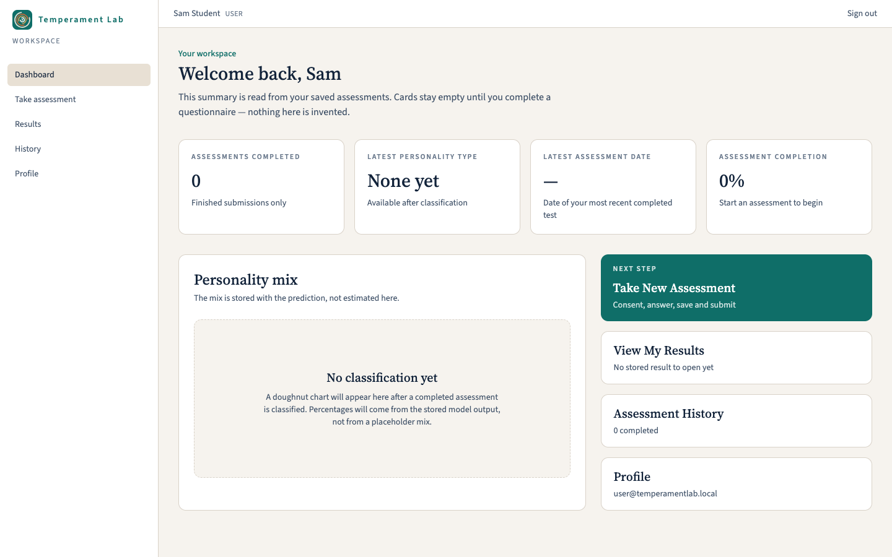

The empty state is intentional. Cards show `0`, `None yet`, and “No classification yet” until a questionnaire is completed and classified. Nothing on this page is a placeholder mix.

### 3.2 Consent

Open **Take assessment**.

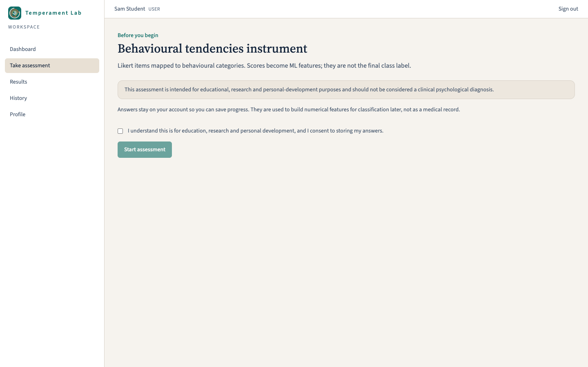

1. Read the instrument name and the educational disclaimer.
2. Tick the consent checkbox. The assessment will not start without it.
3. Click **Start assessment**.

Consent is stored on the assessment row (`consent_accepted_at`). Answers are used later as features, not as a medical record.

### 3.3 Answer the Likert instrument

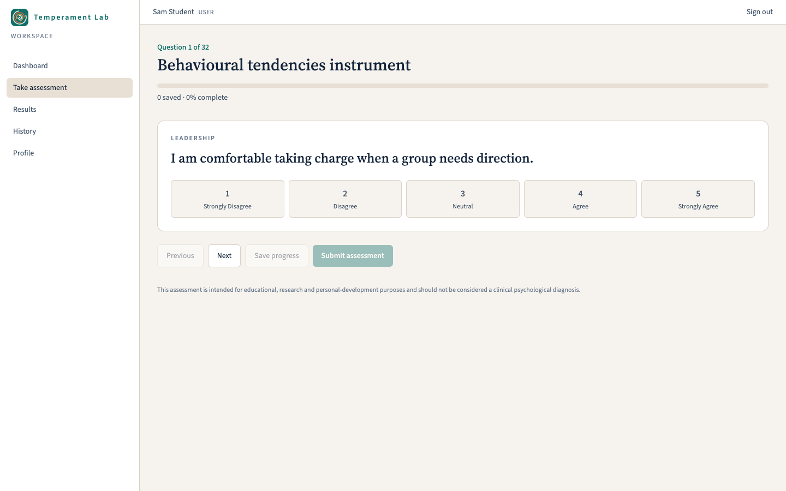

- Version `v1` has **32** items (for example “I am comfortable taking charge when a group needs direction”).
- Scale: 1 Strongly Disagree … 5 Strongly Agree.
- **Save progress** writes answers without submitting.
- **Previous** / **Next** move between items.
- **Submit assessment** is enabled only when every active item has an answer.

### 3.4 Immediate classification notice

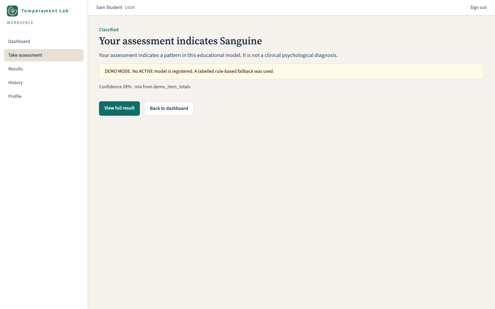

On the capture date the notice was:

- Headline: **Your assessment indicates Sanguine**
- DEMO MODE: *No ACTIVE model is registered. A labelled rule-based fallback was used.*
- Confidence **28%** · mix source `demo_item_totals`

Say this out loud in the viva: this is **not** a trained sklearn prediction, because no model was ACTIVE. The fallback normalises personality-linked item totals. It is labelled DEMO MODE.

### 3.5 Full result

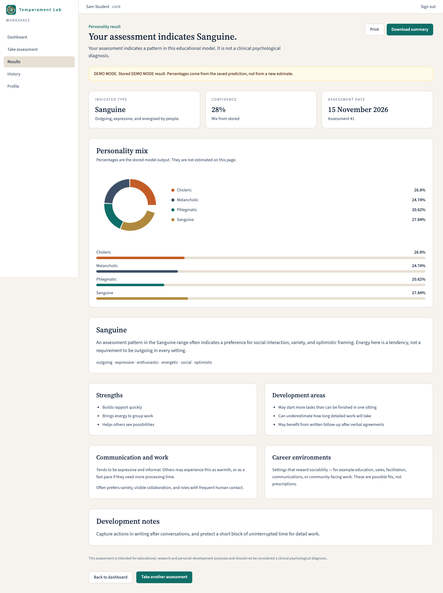

Stored mix on the capture date (DEMO MODE, not a research finding):

| Choleric | Melancholic | Phlegmatic | Sanguine |
|---|---|---|---|
| 26.8% | 24.74% | 20.62% | 27.84% |

The doughnut and bars are that stored mix. **Print** and **Download summary** use the same stored values. Strengths, development areas, and career copy come from `personality_types` in MySQL.

### 3.6 Dashboard after classification

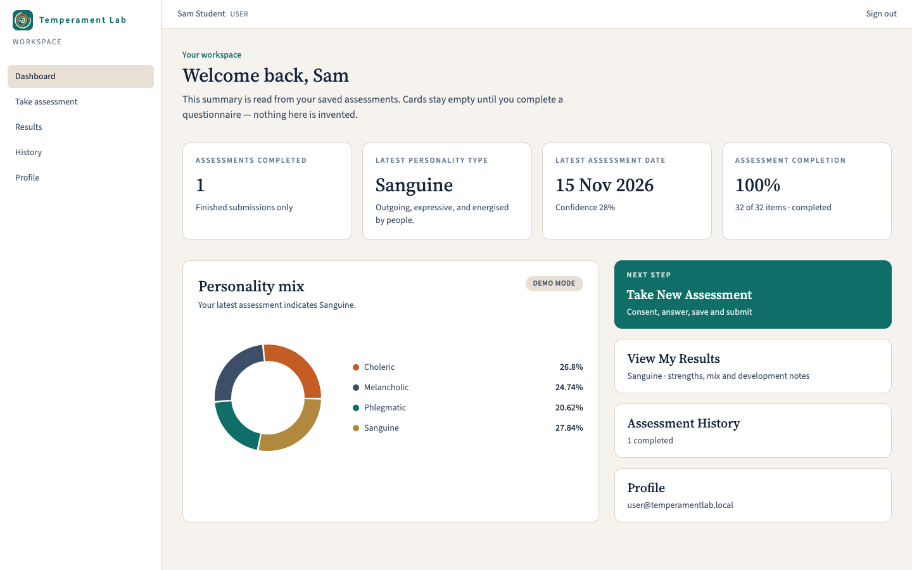

The dashboard now reads the saved row: 1 completed assessment, indicated type Sanguine, 15 Nov 2026, 32 of 32 items, DEMO MODE badge on the mix chart.

### 3.7 History

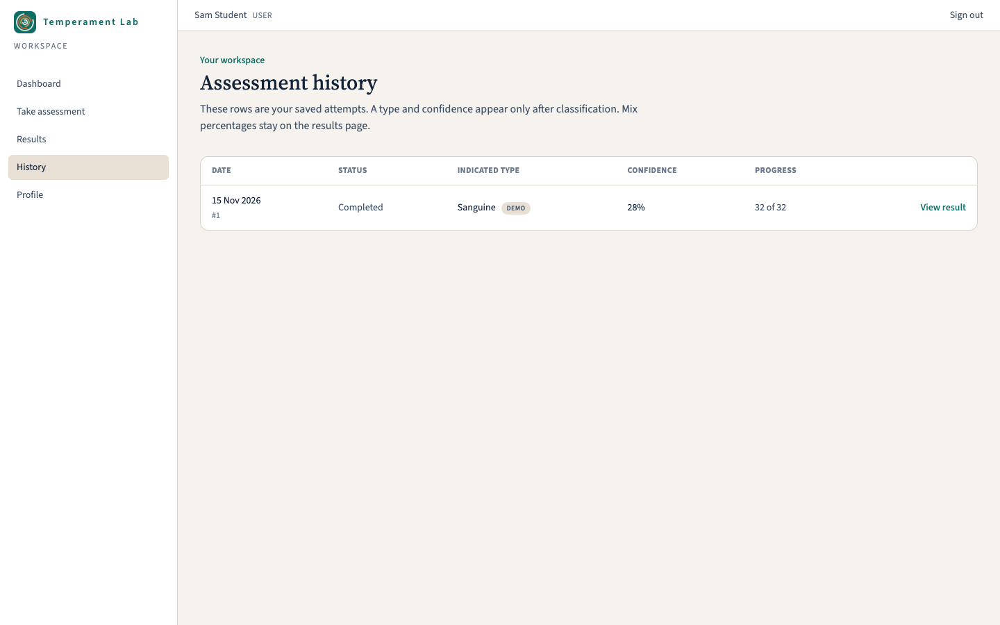

Each attempt is one row. Type and confidence appear only after classification. Mix percentages stay on the results page. The DEMO badge on Sanguine is the same flag as `is_demo_mode` on `prediction_results`.

### 3.8 Profile

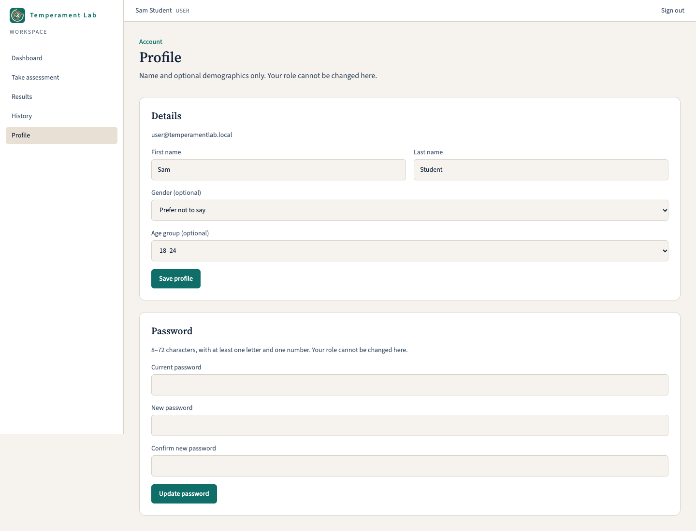

Participants can update name, optional gender, optional age group, and password. **Role cannot be changed here.** Email is displayed but is not an editable field on this form.

**Sign out** returns to the public site.

---

## 4. Administrator (ADMIN) guide

Sign in with the administrator account. The header shows **Ada Admin · ADMIN**. Sidebar: Overview, Users, Questions, Assessments, Models, Dataset, Training, Analytics, Audit log. **User app** opens the participant workspace with the same account.

### 4.1 Overview

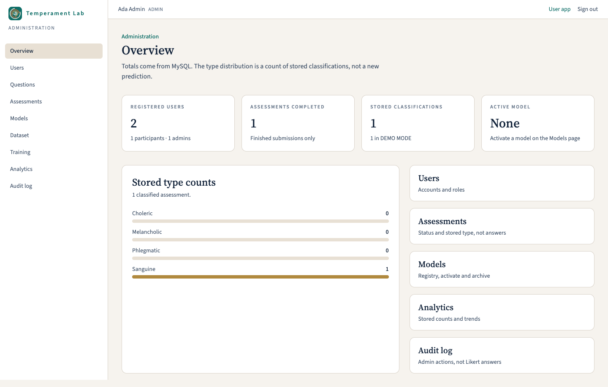

Capture-date totals (MySQL counts, not a new prediction):

| Registered users | Assessments completed | Stored classifications | Active model |
|---|---|---|---|
| 2 (1 participant · 1 admin) | 1 | 1 (in DEMO MODE) | None |

Stored type counts: Sanguine 1; the other three types 0. The page text states that this distribution is a count of stored classifications.

### 4.2 Users

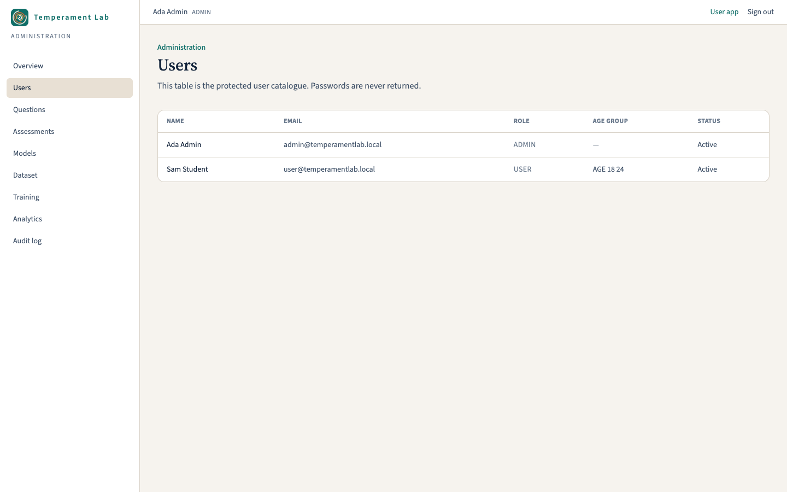

Protected catalogue. Passwords are never returned. Capture date: Ada Admin (`ADMIN`) and Sam Student (`USER`, age group 18–24).

### 4.3 Questions

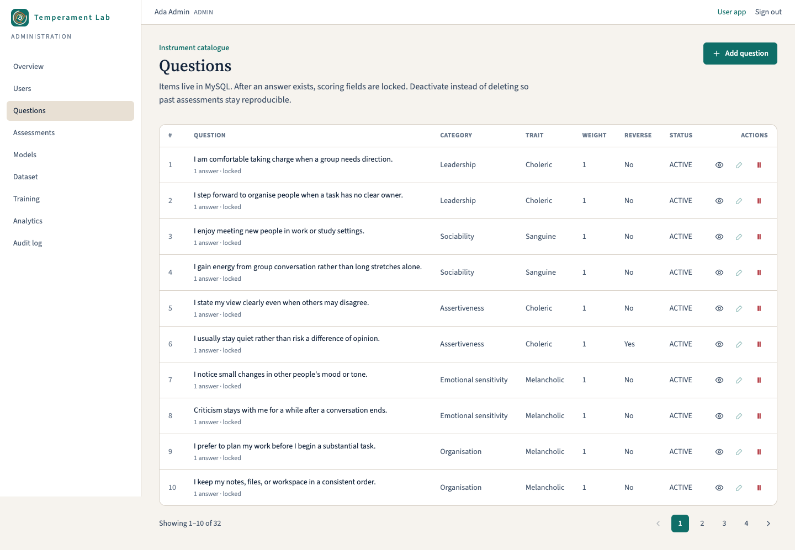

- 32 Likert items live in MySQL, paginated 10 per page.
- Columns: category, trait, weight, reverse scoring, status.
- After an answer exists, scoring fields are **locked**. Deactivate instead of deleting so old assessments stay reproducible.
- **Add question** opens a modal (create on the active questionnaire version).

### 4.4 Assessments (no Likert answers)

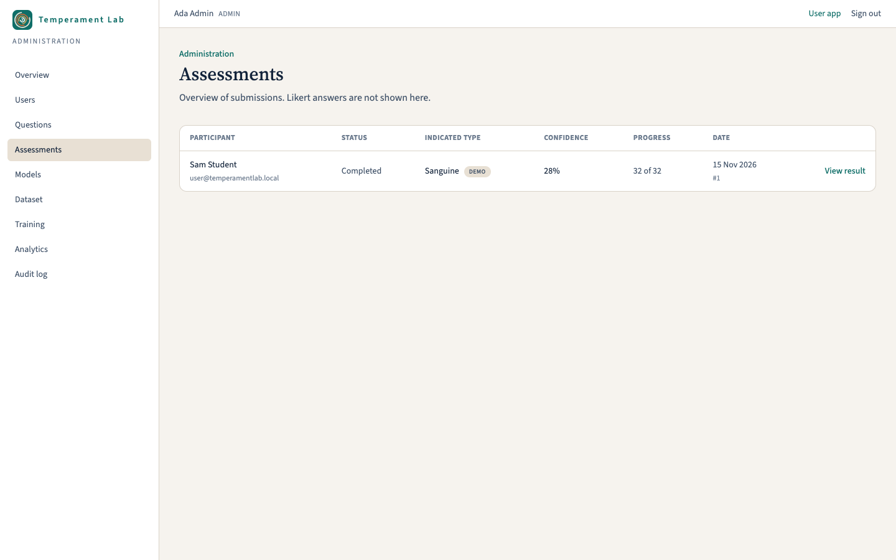

Administrators see status, indicated type, confidence, progress, and date. **Likert answers are not shown here.** Capture date: Sam Student, Completed, Sanguine DEMO, 28%, 32 of 32.

### 4.5 Models

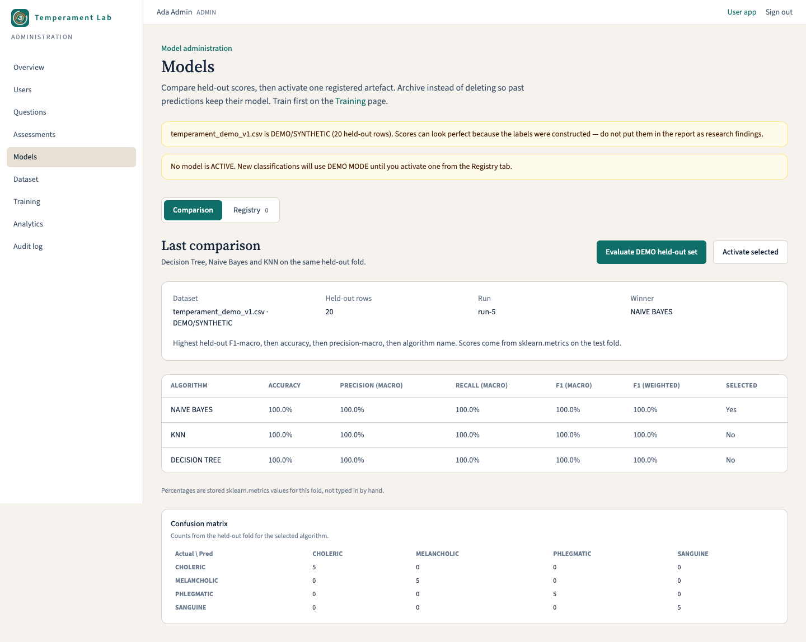

Read the yellow banners with the examiner:

- `temperament_demo_v1.csv` is **DEMO/SYNTHETIC** (20 held-out rows). Scores can look perfect because labels were constructed — **do not put them in the report as research findings**.
- **No model is ACTIVE.** New classifications use DEMO MODE until one registry row is activated.
- Registry tab showed **0** registered artefacts on the capture date.
- Last comparison table showed 100.0% for Naive Bayes, KNN, and Decision Tree on that synthetic fold. Those figures are sklearn metrics on DEMO data, not findings.

To use a trained classifier for participants:

1. Train on **Training**.
2. Evaluate on **Models**.
3. **Activate selected** (or activate one registry row).
4. New classifications then store `model_id` and `is_demo_mode` according to the artefact (synthetic training still keeps a DEMO warning).

### 4.6 Dataset

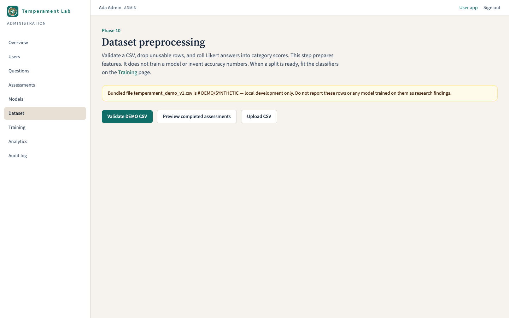

This page validates a CSV and rolls Likert answers into category scores. It does **not** train a model and does **not** invent accuracy numbers.

- **Validate DEMO CSV** — bundled synthetic file, labelled as such.
- **Preview completed assessments** — map real submissions to features.
- **Upload CSV** — same preprocessor on an uploaded file.

### 4.7 Training

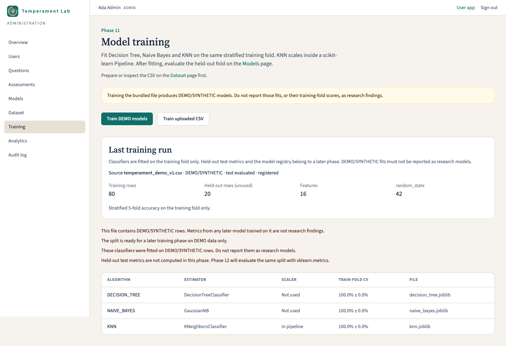

**Train DEMO models** fits Decision Tree, Naive Bayes, and KNN on the same stratified training fold (KNN inside a scikit-learn Pipeline with a scaler). Capture-date last run:

| Source | Training rows | Held-out rows | Features | random_state |
|---|---|---|---|---|
| `temperament_demo_v1.csv` · DEMO/SYNTHETIC | 80 | 20 (unused in this phase) | 16 | 42 |

Train-fold CV on that synthetic file showed 100.0% ± 0.0% for all three algorithms. **Do not report those fits as research findings.** Held-out test metrics belong on the Models page.

### 4.8 Analytics

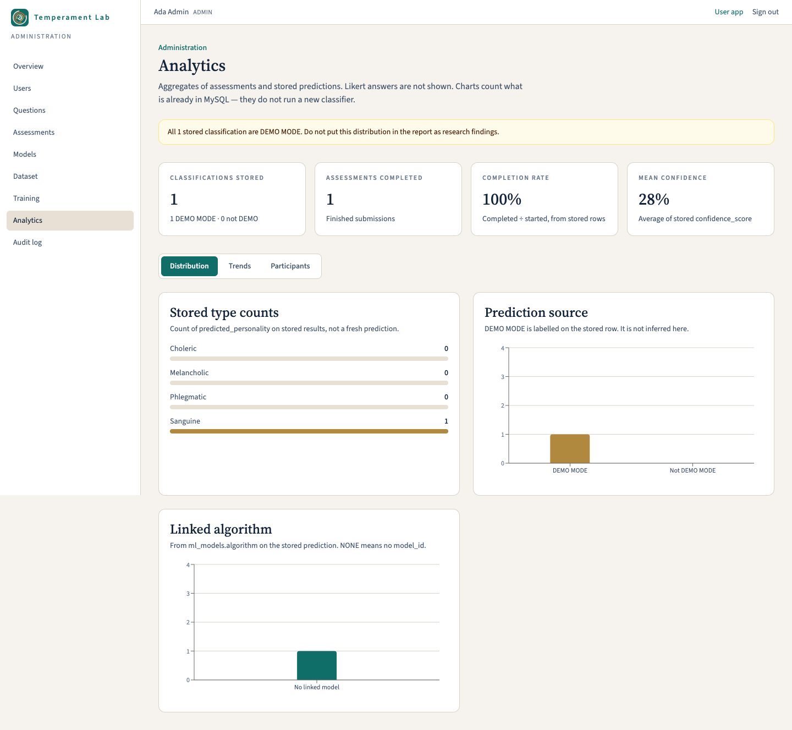

Aggregates of rows already in MySQL. Charts do not run a new classifier. Capture date: 1 DEMO MODE classification, 0 not-DEMO, mean stored confidence 28%, linked algorithm “No linked model”. The banner says not to put that distribution in the report as a research finding.

### 4.9 Audit log

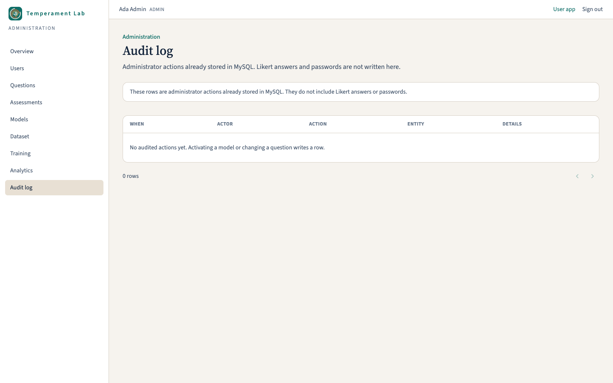

Append-only administrator actions (activate model, change question, …). Likert answers and passwords are not stored here. Capture date: **0 rows** — activating a model or changing a question writes the first row.

---

## 5. UML and design diagrams

These diagrams describe the implemented system (React SPA, FastAPI, MySQL/MariaDB, scikit-learn). They are consistent with `docs/ARCHITECTURE.md` and the SQLAlchemy models.

### 5.1 Use case diagram

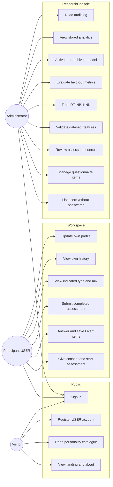

**Include relationship:** Submit includes “every active item answered”. Classification includes either an ACTIVE sklearn model or the labelled DEMO fallback.

### 5.2 Class diagram (domain)

Attributes shown are the fields that matter in a viva. Mixins add `created_at` / `updated_at` on several tables.

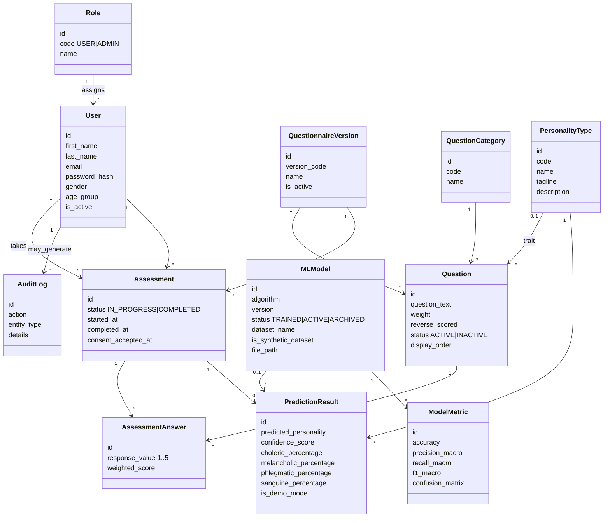

### 5.3 Object diagram (capture-date snapshot)

Objects below are the live demonstration rows after the Edge walkthrough on 15 November 2026. They are not invented examples.

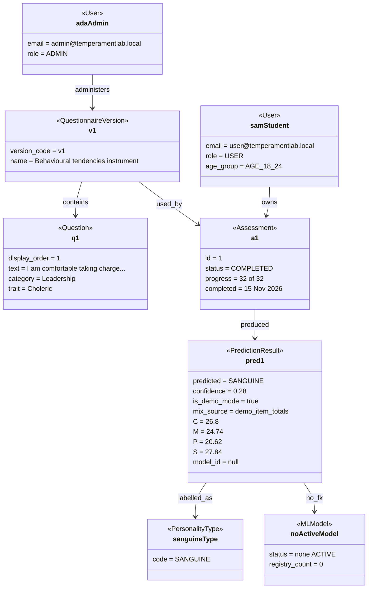

### 5.4 Sequence diagram — participant classifies an assessment

```mermaid
sequenceDiagram
  autonumber
  actor U as Participant
  participant SPA as React app
  participant API as FastAPI
  participant DB as MySQL
  participant ML as predict.py

  U->>SPA: Sign in
  SPA->>API: POST /api/auth/login
  API->>DB: verify bcrypt, load role
  API-->>SPA: JWT + user

  U->>SPA: Consent and start
  SPA->>API: POST /api/assessments
  API->>DB: insert Assessment IN_PROGRESS
  API-->>SPA: assessment id

  loop Each Likert item
    U->>SPA: Choose 1..5
    SPA->>API: POST /api/assessments/{id}/answers
    API->>DB: upsert AssessmentAnswer + weighted_score
  end

  U->>SPA: Submit
  SPA->>API: POST /api/assessments/{id}/submit
  API->>DB: require all active items; set COMPLETED
  SPA->>API: POST /api/predictions/classify
  API->>DB: load answers + instrument
  API->>ML: features_from_assessment
  alt ACTIVE sklearn artefact
    ML-->>API: predict + predict_proba mix
  else No ACTIVE model
    ML-->>API: demo_inference, is_demo_mode true
  end
  API->>DB: insert PredictionResult
  API-->>SPA: predicted type, mix, DEMO flag
  SPA-->>U: “Your assessment indicates …”
```

### 5.5 Sequence diagram — administrator activates a model

```mermaid
sequenceDiagram
  autonumber
  actor A as Administrator
  participant SPA as Admin UI
  participant API as FastAPI
  participant ML as sklearn + joblib
  participant DB as MySQL

  A->>SPA: Train DEMO models
  SPA->>API: POST /api/admin/models/train/demo
  API->>ML: fit DT, NB, KNN on training fold
  ML-->>API: joblib paths + train-fold CV
  API-->>SPA: last training run (DEMO/SYNTHETIC)

  A->>SPA: Evaluate DEMO held-out set
  SPA->>API: POST /api/admin/models/evaluate/demo
  API->>ML: sklearn.metrics on test fold
  API->>DB: register MLModel + ModelMetric
  API-->>SPA: comparison table

  A->>SPA: Activate selected
  SPA->>API: POST /api/admin/models/activate-selected
  API->>DB: previous ACTIVE -> ARCHIVED; winner -> ACTIVE
  API->>DB: insert AuditLog
  API-->>SPA: one ACTIVE model
```

Until that last step succeeds, participant classification stays in DEMO MODE (as in the Edge screenshots).

### 5.6 Activity diagram — assessment to stored result

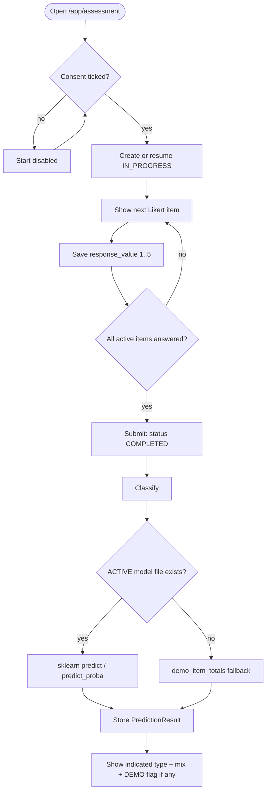

### 5.7 Entity-relationship diagram

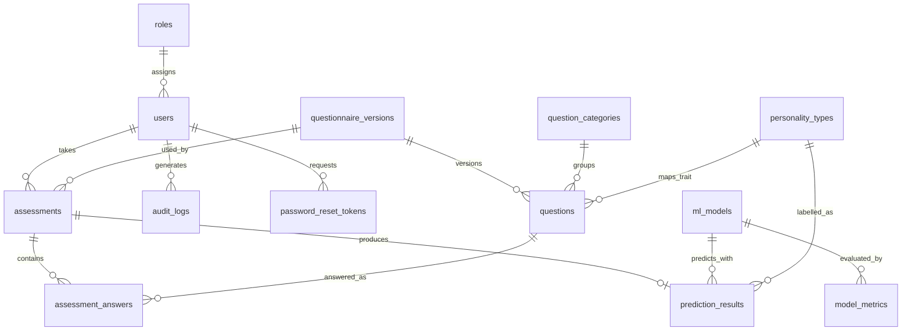

### 5.8 Component diagram

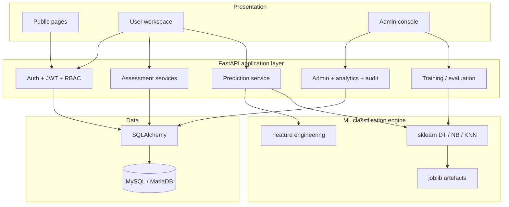

### 5.9 Deployment diagram (live)

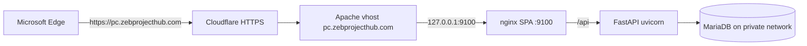

The SPA is a React build served by nginx. `/api` is reverse-proxied to FastAPI. The public site does not expose the database port.

### 5.10 Layered architecture (defence slide)

```
Presentation   React + Vite + Tailwind + React Router + Axios
Application    FastAPI, Pydantic, JWT, RBAC
Data           MySQL, SQLAlchemy
ML engine      pandas, scikit-learn, joblib
```

Routers never train models. ML code never speaks HTTP. Repositories never issue JWT tokens.

---

## 6. Screenshot index

All images were captured from **Microsoft Edge** against [https://pc.zebprojecthub.com/](https://pc.zebprojecthub.com/) on 15 November 2026.

| File | Screen |
|---|---|
| `screenshots/01-home.png` | Landing hero |
| `screenshots/02-home-how-it-works.png` | How it works |
| `screenshots/03-home-footer.png` | Landing footer |
| `screenshots/04-personality-types.png` | Four classes |
| `screenshots/05-about.png` | About |
| `screenshots/06-register.png` | Registration |
| `screenshots/07-login.png` | Login |
| `screenshots/07b-user-dashboard-before.png` | User dashboard, empty |
| `screenshots/08-assessment-consent.png` | Consent |
| `screenshots/09-assessment-question.png` | Likert item 1 of 32 |
| `screenshots/10-assessment-complete.png` | DEMO MODE classification notice |
| `screenshots/11-results.png` | Stored result and mix |
| `screenshots/12-user-dashboard.png` | User dashboard after result |
| `screenshots/13-history.png` | History |
| `screenshots/14-profile.png` | Profile |
| `screenshots/15-admin-overview.png` | Admin overview |
| `screenshots/16-admin-users.png` | Users |
| `screenshots/17-admin-questions.png` | Questions |
| `screenshots/18-admin-assessments.png` | Assessments |
| `screenshots/19-admin-models.png` | Models / DEMO comparison |
| `screenshots/20-admin-dataset.png` | Dataset |
| `screenshots/21-admin-training.png` | Training |
| `screenshots/22-admin-analytics.png` | Analytics |
| `screenshots/23-admin-audit.png` | Audit log |

To recapture after a UI change, from this folder:

```bash
npm install playwright-core
node capture-screenshots.mjs
```

That script launches the installed Microsoft Edge (`channel: msedge`) and writes PNG files into `screenshots/`.

---

## Related documents

- [Project-owners training script](PROJECT_OWNERS_TRAINING.md) — live facilitator order from an empty database
- [Architecture](../ARCHITECTURE.md) — ERD, API plan, defence notes
- [Project README](../../README.md) — stack, local setup, endpoint list
